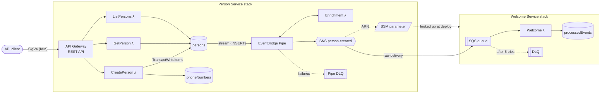

# Person Service

A serverless microservice on AWS that stores persons and publishes a `PersonCreated` event to
the rest of the microservice landscape for every new person. Built with AWS CDK (TypeScript) and
Lambdas on Node.js 24.

- `POST /person` creates a person (first name, last name, phone number, address) in DynamoDB.
- Each new person fires a versioned `PersonCreated` event on an SNS topic.
- `GET /person` (paginated) and `GET /person/{id}` read persons back.
- The same code deploys to a `dev` and a `prod` stage, each in its own AWS account.
- A separate **Welcome Service** shows how another team would consume the event.

## Architecture



### How a person is created

1. API Gateway checks the caller's IAM signature and throttles the stage (10 rps, burst 20).
2. `CreatePerson` validates and trims the body, and normalises the phone number to E.164
   (`06 12345678` → `+31612345678`; numbers without a country code are read as Dutch).
3. In one DynamoDB transaction it writes the person to `persons` and claims the phone number in
   `phoneNumbers`. If the number is already taken, the transaction fails and the API returns
   `409`, so no race can create a duplicate.
4. The `persons` table stream feeds an EventBridge Pipe. The Pipe keeps only `INSERT`s, turns
   each one into a `PersonCreated` event (enrichment Lambda) and publishes it to SNS.

The event comes from the table stream, not from the API Lambda (the outbox pattern). An event
exists only if the write committed, and a failed publish can't leave a person without an event.

### The microservice landscape

The Person Service doesn't know who consumes its events. It publishes the topic ARN to the SSM
parameter `/person-service/<stage>/person-created-topic-arn`. That parameter name and the event
schema are its only public contracts. The Welcome Service reads the parameter at deploy time and
owns its own subscription, queue, dead-letter queues and alarms. No CloudFormation exports link
the two stacks, so each one can be deployed alone. In a real landscape the Welcome Service would
live in its own repository and account.

## API

Every method requires IAM authentication (AWS Signature V4). The caller needs `execute-api:Invoke`
on the API. A plain `curl` gets `403`; use [awscurl](https://github.com/okigan/awscurl), Postman's
"AWS Signature" auth or an AWS SDK.

### `POST /person`

```bash
awscurl --service execute-api --region eu-west-1 -X POST \
  -H 'Content-Type: application/json' \
  -d '{"firstName":"Ada","lastName":"Lovelace","phoneNumber":"06 12345678","address":"Dam 1, 1012 JS Amsterdam"}' \
  "${API_URL}person"
```

All four fields are required, must be non-empty strings of at most 200 characters, and no other
fields are allowed.

| Status            | When                                                          | Body                                                  |
| ----------------- | ------------------------------------------------------------- | ----------------------------------------------------- |
| `201 Created`     | Person stored                                                 | The person; `Location: /person/{id}` header           |
| `400 Bad Request` | Invalid JSON, missing or unknown fields, invalid phone number | `{ "message": "Validation failed", "errors": [...] }` |
| `409 Conflict`    | A person with this phone number already exists                | `{ "message": "..." }`                                |
| `500`             | Unexpected error (logged without personal data)               | `{ "message": "Internal server error" }`              |

```json
{
  "id": "1249302d-9c20-4a1f-8cf5-afdd0173f2a9",
  "firstName": "Ada",
  "lastName": "Lovelace",
  "phoneNumber": "+31612345678",
  "address": "Dam 1, 1012 JS Amsterdam",
  "createdAt": "2026-11-04T14:12:09.077Z"
}
```

### `GET /person/{id}`

Returns `200` with the person, `404` if there is none, or `400` if the id isn't a UUID. The read
is strongly consistent, so following the `Location` header right after a `POST` always finds the
person.

### `GET /person?limit=20&cursor=...`

Returns one page: `{ "items": [...], "nextCursor": "..." }`. `limit` is 1–100 (default 20). Pass
`nextCursor` back as `cursor` for the next page, and stop when it is absent. The order is not
defined, and a page may be empty while `nextCursor` is still present.

## The `PersonCreated` event

Published on SNS topic `person-service-<stage>-person-created`:

```json
{
  "eventType": "PersonCreated",
  "version": 1,
  "eventId": "c4ca4238a0b923820dcc509a6f75849b",
  "occurredAt": "2026-11-04T14:12:09.077Z",
  "data": {
    "id": "1249302d-9c20-4a1f-8cf5-afdd0173f2a9",
    "firstName": "Ada",
    "lastName": "Lovelace",
    "phoneNumber": "+31612345678",
    "address": "Dam 1, 1012 JS Amsterdam",
    "createdAt": "2026-11-04T14:12:09.077Z"
  }
}
```

- **Contract:** defined in [`src/events.ts`](src/events.ts). Additive changes keep `version: 1`;
  breaking changes need a new version. The fields in `data` are picked one by one, so a new table
  attribute never leaks into the event.
- **Delivery is at least once.** `eventId` is the stream record's id: unique per person and the
  same on every redelivery, so consumers deduplicate on it. The Welcome Service claims each
  `eventId` with a conditional write before it acts.
- **Failures:** the Pipe retries 10 times, splits failing batches in half, then sends the record
  to a dead-letter queue. That message holds the stream position, not the person, so it must be
  reprocessed within the stream's 24-hour retention. An alarm fires on the first message.

## Deploying

### Prerequisites

- Node.js 24 and npm. The [dev container](.devcontainer/) has the toolchain ready, including the
  AWS CLI and the CDK CLI.
- AWS credentials for the target account in the environment (`AWS_ACCESS_KEY_ID`,
  `AWS_SECRET_ACCESS_KEY`, `AWS_SESSION_TOKEN`).
- Each stage is bound to an account in [`cdk.json`](cdk.json) (`stageAccounts`). CDK refuses to
  deploy when the credentials belong to another account, so dev keys can never change prod. To
  deploy into your own accounts, change these ids.

### Commands

```bash
npm ci
npx cdk bootstrap -c stage=dev               # once per account and region
npx cdk deploy --all -c stage=dev            # Person Service, then Welcome Service
npx cdk deploy --all -c stage=prod           # with prod credentials
npx cdk deploy --all -c stage=dev -c alarmEmail=you@example.com   # optional alarm emails
```

The stack outputs `ApiUrl` (ends in `/<stage>/`) and `PersonCreatedTopicArn`.

### Differences between stages

|                                           | dev         | prod         |
| ----------------------------------------- | ----------- | ------------ |
| Account                                   | dev sandbox | prod sandbox |
| Tables, topic, log groups on stack delete | Deleted     | Retained     |
| DynamoDB deletion protection              | Off         | On           |
| Point-in-time recovery                    | On          | On           |

Resource names carry the stage (`person-service-dev`, `PersonService-prod`, ...), and every
resource is tagged with `Service` and `Stage`.

## Operations

- **Scaling:** Lambda, API Gateway, on-demand DynamoDB, Pipes, SNS and SQS all scale with traffic
  and cost close to nothing when idle. There are no servers or capacity settings to manage.
- **Alarms:** each service has its own alarm topic. Alarms fire on Lambda errors, API 5XX
  responses, any message in a dead-letter queue, and a Welcome queue backlog older than 5 minutes.
- **Logs:** structured JSON, kept for one month. Handlers log ids and error names only, never
  names, phone numbers or addresses. The Pipe logs errors only, without the record contents.
- **Security:** IAM auth on every method, least-privilege grants (for example, `CreatePerson` may
  only `PutItem`), TLS enforced on topics and queues, SQS encrypted at rest.

## Development

```bash
npm test             # Vitest: handlers (AWS SDK mocked), event mapping, CDK assertions and snapshots
npm run test:update  # update CDK snapshots after an intended infrastructure change
npm run typecheck
npm run lint
npm run format:check
npx cdk synth -c stage=dev
```

```
bin/        CDK app: one Person Service and one Welcome Service stack per stage
lib/        CDK constructs (storage, API, events, alarms) and stacks
src/        Lambda handlers and the domain code they share (validation, event mapping)
test/       Unit tests and CDK template tests
```

## Design decisions

| Decision                                      | Why                                                                                                                            | Trade-off                                                                            |
| --------------------------------------------- | ------------------------------------------------------------------------------------------------------------------------------ | ------------------------------------------------------------------------------------ |
| AWS CDK in TypeScript                         | Same language as the Lambdas, typed, `grant*` helpers for least privilege                                                      | Synthesised CloudFormation is less direct to read than SAM's YAML                    |
| REST API with IAM auth                        | Uses existing AWS identities; leaves room for WAF, request validation and usage plans                                          | Costs more per request than an HTTP API                                              |
| DynamoDB, two tables                          | A transaction over `persons` and `phoneNumbers` rejects duplicate phone numbers atomically; only person items reach the stream | Two tables instead of one single-table design                                        |
| Phone number as the duplicate key             | A clear, normalisable identity for a person                                                                                    | People who share a phone number can't both register                                  |
| Address as a single string                    | Keeps the API simple and works for any country                                                                                 | No validation of postcode or country; structured fields are an easy, additive change |
| Stream → Pipe → SNS (outbox pattern)          | No dual write; Pipes provides retries, filtering and a DLQ without code                                                        | Pipes is newer and harder to debug than a small Lambda                               |
| SNS fan-out, consumers own their SQS queues   | New consumers subscribe without changes to the Person Service                                                                  | No replay or schema registry, unlike an EventBridge bus                              |
| Topic ARN in SSM, not a CloudFormation export | Stacks deploy independently; an export would block changes to the topic                                                        | No deploy-time check that the consumer's subscription still exists                   |
| arm64 Lambdas on Node.js 24                   | About 20% cheaper; the current LTS runtime                                                                                     | Native dependencies would need arm64 builds (none are used)                          |

## Known limitations and next steps

- **Personal data in the event.** The topic is not encrypted yet, and every subscriber receives
  the name, phone number and address. Next: a customer-managed KMS key for the topic, and an
  event that carries only the id plus what consumers really need.
- **No CI/CD.** Deploys are manual `cdk deploy` runs. Next: GitHub Actions for lint and tests,
  then deploys to dev and prod through an OIDC role.
- **Validation lives only in the Lambda.** Next: an API Gateway request model to reject bad
  requests at the edge, and Zod as the single schema in the handler.
- **Observability.** No tracing or correlation id from the API request to the consumer yet. Next:
  Powertools for AWS Lambda (Logger, Tracer, Metrics) and X-Ray.
- **Welcome Service crash window.** If the Lambda crashes or times out between claiming an
  `eventId` and finishing the welcome, retries skip that event. A claim with a "pending" state
  and an expiry would fix this.
- **No event filtering.** The Pipe sets no SNS message attributes, so subscribers can't use
  filter policies yet.
